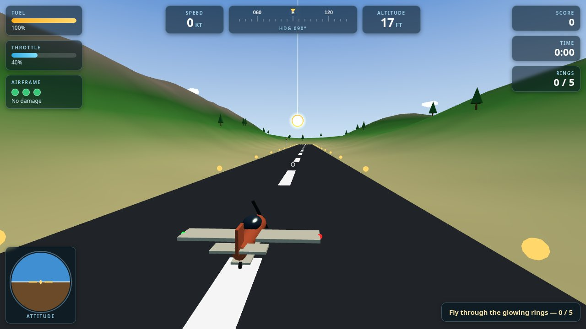

# Sembel Sky Courier

A complete little flight game that runs offline in a desktop browser. You fly a
small prop courier plane over an island archipelago: chase the glowing rings,
mind your fuel, and bring her down gently on the runway to finish the delivery.

## Play

Open `game/index.html` in desktop Chrome (or serve the `game/` folder with any
static server). No network request is made while it plays.

- **Mouse** — steer: move to bank and pitch, the plane follows your hand
- **W / Up** — throttle up, **S / Down** — throttle down
- **C** — switch chase view / cockpit view
- **R** — restart the sortie, **P** — pause, **M** — mute
- **Click Start** — begin; fly through every ring, then land on the runway

## What is in the game

- A 3D archipelago with sea, beaches, hills, clouds and a lit runway
- A courier plane built from primitives, with a spinning propeller and nav lights
- Arcade flight: throttle, lift, banked turns, stall, wind
- Missions: rings in order, deliveries, a timer and a score
- Fuel that burns and damage from hard landings and crashes
- A full HUD: altitude, speed, heading compass, fuel, throttle and horizon
- Procedural sound only: engine hum, wind and ring chimes, no audio files

## Tech

- `three.js` (vendored as `game/vendor/three.module.min.js`) for the 3D scene
- Plain ES modules under `game/js/`, one file per job, no build step
- Static files only: everything the page loads lives under `game/`

## Entry

Built for the make.fun bounty "Make the best flight game"
(`best-flight-game-20261126-0057`). `main.ts` hands the game in: it copies
`game/` and `screenshots/` to the output directory and writes `dossier.json`.

## License

MIT — see [LICENSE](LICENSE).
